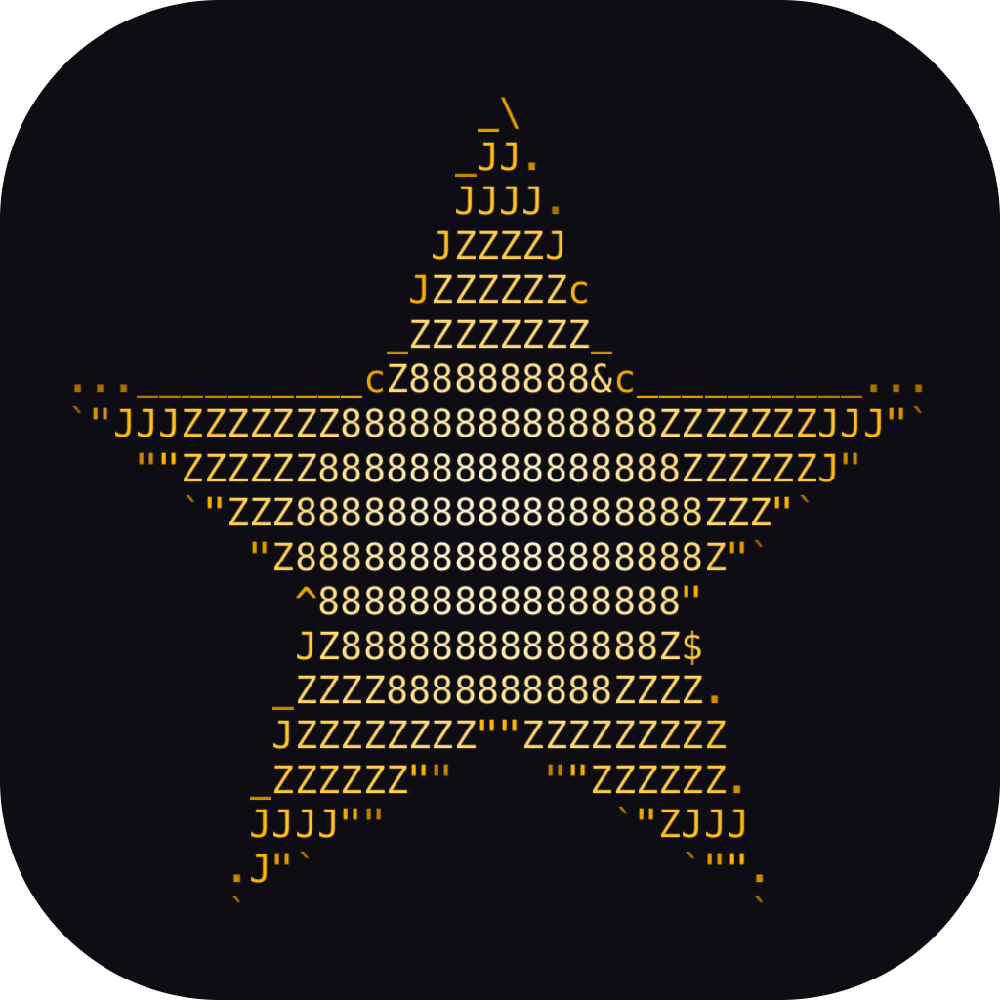

# ASCII by Star

A Photoshop plugin that turns any image into ASCII and glyph art, with a live preview.



## Install (any Mac with Photoshop 2024 / v25 or newer)
1. Copy **`ASCII by Star.ccx`** to that Mac.
2. Double-click it. Creative Cloud installs it and will warn that it's not from the marketplace; confirm.
3. Restart Photoshop and open **Plugins ▸ ASCII by Star**.

Works with RGB and Grayscale documents at 8, 16 and 32 bits per channel, including artboard documents.

## Features
- **Any installed font**, including your own. Search the list, or pick a font in Photoshop's font menu on a text layer and click **From text layer**. Photoshop renders it once, then it's cached.
- **Reset all** button restores every default.
- 63 character sets: classic ASCII ramps, blocks, Braille, box drawing, katakana "Matrix", runes, symbols, or type your own.
- Shape matching: picks characters that follow edges, not just brightness.
- Tone controls: contrast, brightness, gamma, threshold, invert.
- 21 dithering modes: error diffusion (Floyd–Steinberg, False FS, Atkinson, Jarvis–Judice–Ninke, Stucki, Burkes, Sierra, Two-row Sierra, Sierra Lite), ordered Bayer 2×2, 4×4 and 8×8, halftone screens (round dot, line screens) and blue or white noise. Also a strength slider and serpentine scanning.
- **Glitch** (seeded, so the preview, apply and batch match):
  - Image: pixel sort (rows or columns), slice shift, datamosh blocks, wave, melt, bit crush, channel swap.
  - Characters: corrupt, row shift, stutter.
  - Signal: RGB split, interlace, VHS tracking, scanlines, noise.
  - Plus a **Randomize** button for instant recipes.
- Colour modes: single colour, original image colours (saturation and lift darks), or a 2–3 stop gradient map.
- Backgrounds: solid, transparent, or a colour mosaic behind the characters.
- Size the grid by font size (px) or by number of columns.
- Output: a new pixel layer, an editable text layer (in the chosen font), **PNG at 1×, 2× or 4×** (includes glitch signal effects and keeps transparency), .txt, coloured .html or vector .svg files, or copy to the clipboard.
- Re-edit: select an ASCII by Star layer, click **Re-edit selected…**, adjust, then click **Update layer**.
- Presets: 21 built-in looks, plus your own presets, which you can import and export.
- Batch: process a folder of images to PNG (and optionally .txt).
- **Live preview window**: a separate document that updates as you change settings. Zoom and pan it with Photoshop's own tools (pinch, Z/H, scroll). The panel shows a quick Fit thumbnail.
- **Apply quality**: 1× pixel layer (re-editable in place), or a 2×/4× smart object that holds a higher-resolution render, so it stays sharp when scaled up, upsized (Image Size) or exported.

## Making changes
| What | Where |
|---|---|
| Panel layout | `plugin/index.html` |
| Photoshop logic (read pixels, layers, export, batch) | `plugin/main.js` |
| Rendering engine (pure JS, no Photoshop) | `plugin/engine.js` |
| Character sets | `plugin/charsets.js`, then rebuild the atlas (below) |
| Built-in looks | `plugin/presets.js` |
| Logo and icons | `tools/make_logo.js` writes `logo/` and `plugin/icons/` |

**Build and install:** `tools/package.sh --install`, then restart Photoshop. Without `--install` it only builds the `.ccx`.
Bump `"version"` in `plugin/manifest.json` for each release.

**Rebuild the glyph atlas** (after editing charsets):
```
node -e 'require("fs").writeFileSync("tools/chars.json", JSON.stringify(require("./plugin/charsets.js").allChars()))'
swift tools/gen_atlas.swift tools/chars.json plugin
```

**Test the engine without Photoshop:** `node tools/test_engine.js test/dahlia.png /tmp/out` renders every preset to PNG.
