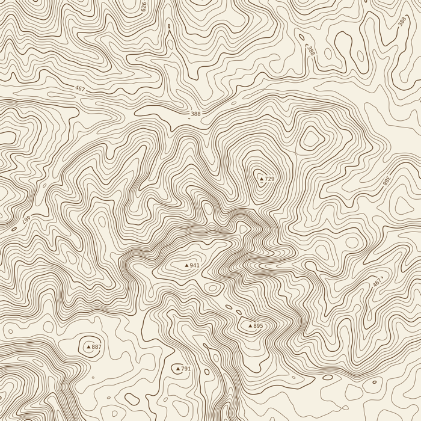
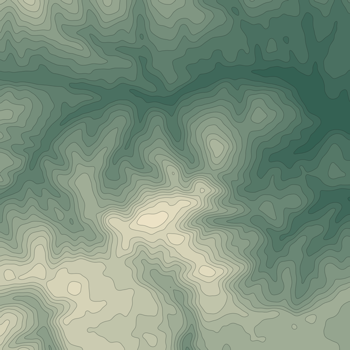
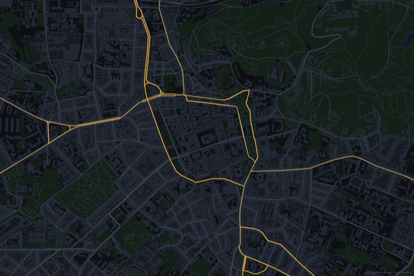

# ASCII by Star

A Photoshop plugin that turns any image into ASCII and glyph art with a live preview, adds realistic ink bleed on paper to any layer, dithers images into any palette, draws FIGlet text art, topographic line art and maps of any place on Earth.

**The most advanced ASCII art editor ever made, right inside Photoshop.** 60+ character sets and any font, 25 looks, shadows, glitch, Matrix rain, outlines and hidden messages, a live smart object, and now **hand editing of every single symbol**: paint, draw lines, rectangles and circles, or select any shape with Photoshop's own tools and rewrite it.


## Install (Photoshop 2024 / v25 or newer)
1. Download the **`.ccx`** file (`ASCII.by.Star.ccx`) from the [latest release](https://github.com/StarodubO/ascii-by-star/releases/latest).
2. Double-click it. Creative Cloud installs it and warns that it isn't from the marketplace; confirm.
3. Restart Photoshop and open **Plugins ▸ ASCII by Star**.

Works with RGB and Grayscale documents at 8, 16 and 32 bits per channel, including artboard documents. Developed and tested on macOS and Windows.

**Tabs:** ASCII, Ink bleed, Dither, Text art, Lines and Map. The **☰** menu left of the tabs puts them in your own order and hides the ones you don't use (**Reset** brings back the default).

## ASCII tab
- **Characters:** 60+ character sets (classic ASCII ramps, blocks, Braille, box drawing, katakana "Matrix", runes, symbols) or your own text, in three ways:
  - **As a brightness ramp:** each character is one tone step.
  - **As words:** words or letter pairs, e.g. `· oo OK WOW ###`. Each covers as many cells as it has letters; darker areas get inkier words.
  - **Written out, repeating:** a phrase fills the image like a typed page, with the picture showing through the letters' shade and colour.
  - **Hidden messages:** text in curly braces is written somewhere inside the picture, e.g. `.:-=+*#%@{HELLO}`; `{XO*5}` hides it five times. The preview can highlight where they went, and **Move** puts them elsewhere.
  - **Fill the artwork:** text in square brackets fills it, in any mode. `[STAR]` writes STAR all over it, `[STAR|LOVE|★]` takes turns, `[?STAR|LOVE|★]` picks at random (**Shuffle** picks again) and `[?01]` scatters single characters. Characters outside the brackets keep drawing the lighter tones (`.:-= [STAR]`), with **Fill from** setting where the fill starts.
- **Any installed font**, including your own: browse every installed font (each shown in its own typeface) or take it from a text layer. Photoshop renders it once, then it's cached. Characters missing from the built-in font are drawn by Photoshop, so nothing you type is dropped.
- **Shape matching:** picks characters that follow edges, not just brightness.
- **Matrix rain:** characters stream down out of the shape into the empty space below it, or fall over the whole image and light up where they cross it. The rain has its own characters (any character set, or your own text, `[ ]` included), length and length spread, amount, fall distance, tail fade, gaps, angle and a bright head. It can use its own colour, the shape's colours or a tail-to-head gradient. A seed fixes the pattern so the preview, the layer and batch output match.
- **Outline** (for text, logos and other high-contrast shapes): a stroke around the shape, outside, centred or inside, 1–6 characters wide, made of lines that follow the edge (`| / - \`) or your own characters, in its own colour. The inside keeps the image, is emptied or is filled with other characters, in order or at random.
- **Edit symbols:** change single characters by hand. Click **Edit** under the preview, then paint freehand, draw lines, rectangles and ellipses (Shift for squares and circles), or select a box of cells and **Apply**: write your own characters (several are written in turn along the shape), recolour, erase, or restore what the image gave a cell. Or start a **Matrix rain** stream from any character, with a set or random length. A Rectangular Marquee in the live smart object or your document can select the box too. Edits stay on their spot in the picture when you change the size or the look, show up in the live smart object, layers and exports, and can be undone one by one.
- **Tone:** contrast, brightness, gamma, threshold, invert, and 21 dithering modes (error diffusion, ordered Bayer, halftone screens, blue/white noise).
- **Colour:** a single colour, the image's own colours, or a 2–3 stop gradient map. The background can be solid, transparent or a colour mosaic. By default the output keeps the source's transparency (cut-out PNGs stay cut out).
- **Shadows:** drop shadow, long / 3D extrude shadow, offset (riso-style) shadow and glow, which can be combined. They scale with the character size.
- **Glitch** (seeded, so the preview, apply and batch all match): pixel sort, slice shift, datamosh, wave, melt, bit crush, channel swap; character corruption, row shift and stutter; RGB split, interlace, VHS tracking, scanlines and noise. Plus a **Random glitch** button.
- **Output:**
  - a pixel layer, or a 2×/4× smart object that stays sharp when scaled up;
  - an editable text layer;
  - PNG at 1×, 2× or 4×;
  - .txt, coloured .html or vector .svg, or copy to the clipboard.
- **Live smart object:** places the result as a smart object and updates it as you change settings, with Photoshop's own zoom and pan.
- **Preview:** zoom with the mouse wheel or the zoom bar, drag to move around, drag the grip under it to make it taller or shorter, or fold it away with **▾ Preview** (nothing is rendered while hidden, handy in live mode).
- **A panel that fits small screens:** fold the preview and the **Controls** under it, fold or unfold every section at once, and drag sections into your own order by their ⠿ grip. Every section has a coloured icon, and the layout is remembered per tab on your computer.
- **Cell backgrounds:** an effect behind every character from its colour: tiles, gradients (linear, radial, diamond, angle, across each cell or the whole picture), bleed, nested "depth" squares, plus per-cell glitch, scanlines and grain.
- **Depth echo:** repeats the outline, the rain or the characters as scaled copies towards a vanishing point, for a 3D tunnel look.
- **Outer ring:** a second outline around the shape, with text, text along rays or rain between the two.
- **Radial rain:** Matrix rain that streams out of a centre or into it, optionally twisted.
- **Separate layers:** output as a group with one layer per part (text, outline, hidden messages, rain, edits, shadows, glitch, depth echo).
- **Re-edit:** select a generated layer, adjust and **Update layer**.
- **Presets:** 25 built-in looks, plus your own presets, which you can import and export. **Reset** takes you back to the chosen look; **Randomize** tries a random one (↶ goes back).
- **Batch:** process a folder of images to PNG (and optionally .txt).

## Ink bleed tab
Adds an ink-on-paper overlay to any layer (or the whole visible image) without touching it. The result is a group named *“<layer> Ink Bleed”* with four blend-mode layers you can fine-tune in Photoshop: **Ink bleed** and **Ink pooling** (Multiply), **Ink gaps** (Normal, showing the paper under your layer through the ink) and **Paper** (Multiply). For light ink on dark paper the modes swap automatically.

- **Paper:** 8 generated paper types (newsprint, office paper, blotting paper, washi, laid paper, cold-press watercolour, kraft, rough print) or **any image file as the paper**: your own scans, at any size. The texture shapes the bleed: ink skips its raised parts and pools in its dips.
- **Bleed:** wetness, distance, feathering, wicking along fibres, halo opacity and edge softness.
- **Inside the ink:** pooling, rim width, granulation, dry skip and mottling.
- **Paper settings:** grain size, grain, relief, fibres (amount, length, visibility, alignment, direction), laid lines and flecks, or texture scale, strength and colour.
- A preview you can zoom (Fit to 400%), drag around, resize or hide. **Update overlay** re-renders in place and keeps your layer tweaks.

## Dither tab
Dithering with full control over every step, written for this plugin. The result goes in a new layer *“<layer> Dither”* (or a group with **a layer per colour**) and can be re-edited later.

- **Pixels:** pixel size in document pixels, drawn as squares, circles, diamonds, lines or pluses with an adjustable gap, on a solid, transparent or picture background.
- **Adjust first:** blur, sharpen, invert, channel mix, hue and saturation, brightness, contrast, gamma and grain.
- **Colours:** a tone gradient through your palette, nearest colour from a palette (RGB, weighted or perceptual OKLab matching), greys between two colours, or levels per RGB channel. 19 built-in palettes (Game Boy, CGA, EGA, PICO-8, Commodore 64, ZX Spectrum, riso, sunset poster…), your own (edit, add and pick colours from the preview), or an automatic palette of N colours taken from the image.
- **Algorithms:** error diffusion (Floyd–Steinberg, Atkinson, Jarvis, Stucki, Burkes, Sierra and more, or your own 8-weight kernel) with serpentine scanning, threshold and jitter; Riemersma along a Hilbert curve; ordered Bayer, clustered-dot and halftone matrices; a continuous halftone screen at any size, angle and dot shape; blue noise, white noise, interleaved gradient and golden-ratio noise. Patterns can be scaled and rotated.
- **Edit:** paint, erase or restore single pixels on the preview with a brush; edits stay in place when the pixel size changes.
- **Glitch** before or after dithering (see below), 16 looks, Randomize, ↶ Undo, a live smart object and **SVG** export.

## Glitch in every tab
The ASCII, Dither, Lines and Map tabs each have a **Glitch** section: slices, wave, broken blocks, pixel sort, RGB split, interlace, VHS tracking, bit crush, channel swap, scanlines and noise, with **Random glitch** and a seed, so the preview, the live view and the layer always match. In Dither and Lines it can tear the result or the picture before the effect (a dithered glitch keeps its palette). Text art gets it through **Use with effects** in the ASCII tab.

## Text art tab
FIGlet lettering like patorjk.com's TAAG, with 332 fonts. Layouts (full, fitted, smushing), alignment, line gap, letter spacing, case, flip, invert, frames, drawing with any character or your own text, and style presets. **Try every font** previews your text in all of them. **Use with effects** sends the art to the ASCII tab, so colours, outlines, rain, shadows and glitch all work on it.

## Lines tab
Contour (topographic) and ridge lines from any layer's brightness, a depth map, or real terrain.



- **Height:** the image, another layer (e.g. a depth map) or **the map**: real elevation for the area chosen in the Map tab, with lines on round metre heights.
- **Lines:** count or interval, smoothing, index lines, widths, colours from the line, the image, or a height gradient, fills between levels and hill shading.



- **Height labels and spot heights** on the lines, facing uphill or readable.
- **Styles:** contours, ridge lines, a **labyrinth** (a Turing pattern whose stripes get wider with height) or a **3D point cloud** you can turn and tilt.
- **Line colours** from a height gradient or across the slope, with a gradient shape: start and end, middle position, curve, hard steps, repeats (mirrored or not) and reverse.
- **Text on the lines:** your text (hidden messages and fills included) written along every contour in any installed font, horizontal or vertical, or direction marks `- \ | /`. Each height can carry its own text (one row per height; **Row per line** fills in each line's height), or random characters from any character set (Standard long, blocks, binary…).
- **Single lines:** click a line on the preview to give it its own text, its own colour, Matrix rain, or hide it.
- **Matrix rain on the lines:** streams running along the contours with a fading tail and a bright head.
- **Output:** a layer, a live smart object or vector **SVG**. **Use with effects** sends the lines to the ASCII tab.

## Map tab
A map of any place: type a name, coordinates, or paste a Google Maps link.



- Buildings, roads (with casings and major roads), rail, rivers, water, parks and bare ground from OpenStreetMap, each with its own colour, width and opacity, and style presets.
- **Names** of places, points of interest, water and peaks, in the local language, English or Latin script and any font, placed without overlaps and with a halo. Peaks get a ▲ and can show the name and height, the name, the height, or just the mark.
- **Drag the preview** to move around; the map is drawn past the edges so moving feels smooth.
- **Output:** one layer per kind of feature in a group, a live smart object, or **SVG**. **Select** turns a category (e.g. all buildings) into a Photoshop selection.
- Map data © OpenStreetMap contributors (the credit line is on by default); heights from AWS Terrain Tiles.

## Making changes
| What | Where |
|---|---|
| Panel layout | `plugin/index.html` |
| Photoshop logic for the ASCII tab (pixels, layers, export, batch) | `plugin/main.js` |
| ASCII rendering engine (pure JS, no Photoshop) | `plugin/engine.js` |
| Ink bleed effect (pure JS) / its tab and Photoshop I/O | `plugin/ink.js` / `plugin/inkui.js` |
| Dither effect / its tab | `plugin/dither.js` / `plugin/ditherui.js` |
| Lines effect / its tab | `plugin/lines.js` / `plugin/linesui.js` |
| Map data, drawing and tab | `plugin/map.js`, `plugin/features.js`, `plugin/mapui.js` |
| Glitch for Dither, Lines and Map / its section | `plugin/glitch.js` / `plugin/glitchui.js` |
| Section icons | `tools/section-icons/*.svg`, then `swift tools/make_section_icons.swift` |
| Wheel-safe sliders and dropdowns | `plugin/slider.js`, `plugin/dropdown.js` |
| Character sets | `plugin/charsets.js`, then rebuild the atlas (below) |
| Built-in looks | `plugin/presets.js` |
| Logo and icons | `tools/make_logo.js` writes `logo/` and `plugin/icons/` |

**Build and install:** `node tools/package.js --install` (macOS and Windows; `tools/package.sh` does the same), then restart Photoshop. Without `--install` it only builds the `.ccx`. Bump `"version"` in `plugin/manifest.json` for each release.

**Rebuild the glyph atlas** (after editing charsets; needs macOS for the Menlo font):
```
node -e 'require("fs").writeFileSync("tools/chars.json", JSON.stringify(require("./plugin/charsets.js").allChars()))'
swift tools/gen_atlas.swift tools/chars.json plugin
```

**Tests without Photoshop:**
- `node tools/test_engine.js test/sample.png /tmp/out` renders every preset to PNG; compare md5s between builds.
- `node tools/test_ink.js test/sample.png /tmp/ink --check` renders every paper type and checks that tiled rendering matches a one-piece render.
- `node tools/test_dither.js test/sample.png /tmp/dither --check`, `node tools/test_lines.js test/sample.png /tmp/lines --check` and `node tools/test_map.js "<place>" /tmp/map --check` do the same for the Dither, Lines and Map tabs (add `--set glOn=true,glSlices=0.5` to check the glitch).
- `node tools/ui_smoke.js` checks the panel builds.
- `test/sample.png` is drawn by `node tools/make_sample.js`.

**Tests in Photoshop:** `node tools/build_test.js` writes `test/gf_test.psjs` (set `TEST=ink`, `shadow`, `text`, `feature`, `rain`, `png` or `depth` for the other suites; `LOG_MIRROR=<file>` also writes the log there). Then run `open -a "Adobe Photoshop 2026" test/gf_test.psjs` on macOS, or on Windows `"C:\Program Files\Adobe\Adobe Photoshop 2026\Photoshop.exe" test\gf_test.psjs` (Photoshop already running; **File ▸ Scripts ▸ Browse…** also works).

## License
[MIT](LICENSE). The built-in glyph atlas (`plugin/atlas.bin`) is rasterised from the Menlo typeface that ships with macOS. Section icons are from [Lucide](https://lucide.dev) (ISC licence, `tools/section-icons/LICENSE`). The Text art tab uses [figlet.js](https://github.com/patorjk/figlet.js) and its FIGlet fonts by Patrick Gillespie and contributors (MIT licence, `plugin/figlet-fonts/LICENSE-figlet.txt`), the engine behind patorjk.com's Text to ASCII Art Generator.
